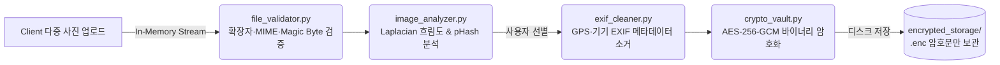

# 📸 찰나정리 (ChalnaClean)
> **OpenCV · pHash 기반 저화질·중복 사진 자동 선별 및 AES-256-GCM 인메모리 암호화 보관 웹 애플리케이션**

스마트폰의 연속 촬영과 메신저 공유로 누적되는 흔들린 사진·중복 사진을 자동으로 분류해 정리하고, 보존할 사진은 개인정보(GPS·기기 EXIF 메타데이터)를 제거한 뒤 디스크에 평문 흔적을 남기지 않는 **Zero-Plaintext-Footprint** 파이프라인으로 암호화 보관하는 보안 중심 웹 서비스입니다.

---

## 🏗️ 시스템 아키텍처 (Zero-Plaintext-Footprint Pipeline)

모든 이미지 분석, 메타데이터 소거, 암호화, 복호화 스트리밍은 **서버 RAM(`io.BytesIO`) 상에서만 수행**되며, 로컬 디스크(`encrypted_storage/`)에는 암호화된 `.enc` 바이너리 파일만 저장됩니다.



---

## 📂 모듈별 책임 분리 구조 (Modular Architecture)

```text
ChalnaClean/
├── app.py                  # Flask 웹 라우팅 및 인메모리 스트리밍 컨트롤러
├── file_validator.py       # 확장자 화이트리스트·MIME·Magic Byte 3단계 업로드 보안 검증
├── image_analyzer.py       # OpenCV Laplacian 분산 흐림 감지 및 64-bit pHash 클러스터링
├── exif_cleaner.py         # Pillow 기반 시각적 회전 유지 및 민감 EXIF 태그 완전 소거
├── crypto_vault.py         # NIST 권장 12B Nonce 기반 AES-256-GCM 바이너리 암복호화 엔진
├── templates/
│   └── index.html          # 다중 업로드 대시보드 및 인메모리 암호화 보관함 UI
├── tests/
│   └── test_security.py    # 암호문 1바이트 변조 탐지(InvalidTag) 등 5대 보안 검증 자동화
└── requirements.txt        # 프로젝트 의존성 패키지 명세
```

---

## 🛡️ 핵심 보안 설계 및 트러블슈팅 성과

### 1. 암호화 파이프라인 리팩토링 (Base64 v1 → 순수 바이너리 v2)
* **문제 상황:** 초기 프로토타입에서 원본 이미지를 Base64 텍스트로 직렬화한 뒤 암호화한 결과, 5.00 MB 고해상도 이미지 기준 암호문 크기가 **8.89 MB (+77.8%)**로 팽창하고 다중 처리 시 메모리 복사·I/O 지연(`36.49 ms`)이 발생함.
* **해결 방법:** 불필요한 Base64 계층을 제거하고 **`[12B 고유 Nonce] + [Ciphertext] + [16B GMAC Auth Tag]`** 순수 바이너리 스트림 포맷으로 리팩토링.
* **정량적 개선 결과 (5.00 MB 단일 이미지 기준):**
  * 암호문 저장 용량: `8.89 MB → 5.00 MB (+28 Bytes)` (**43.7% 절감**, 불필요한 용량 팽창 0%)
  * 암호화 처리 속도: `36.49 ms → 2.74 ms` (**92.5% 단축**)

### 2. 다계층 시큐어 코딩 적용
* **기밀성 및 무결성 동시 보장 (AEAD):** `AES-256-GCM` 모드와 매 암호화마다 `os.urandom(12)`로 생성하는 고유 Nonce를 적용하여, 암호문 중 단 1바이트라도 변조될 경우 `InvalidTag` 예외로 복호화 및 열람을 즉시 차단.
* **프라이버시 보호 (EXIF Cleansing):** 암호화 직전 메모리 버퍼에서 촬영 위치(GPS), 기기 모델명, 촬영 일시 등 EXIF 메타데이터를 완전히 제거.
* **업로드 공격 방어:** 확장자 위변조 파일(`.jpg`로 위장한 비이미지 바이너리)을 차단하기 위해 파일 헤더 시그니처(Magic Byte) 대조 로직 적용.
* **비밀키 분리 관리:** 마스터 키는 소스 코드에 하드코딩하지 않고 `.env` 환경변수로 분리하여 `.gitignore`로 원격 저장소 노출 원천 차단.

---

## 🚀 로컬 실행 및 보안 테스트 방법

### 1. 환경 구성 및 패키지 설치
```bash
git clone [https://github.com/joosangdon/ChalnaClean.git](https://github.com/joosangdon/ChalnaClean.git)
cd ChalnaClean
python -m venv venv
.\venv\Scripts\Activate.ps1
pip install -r requirements.txt
```

### 2. 환경변수(`.env`) 마스터 키 생성
프로젝트 루트 경로에 `.env` 파일을 생성하고 32바이트(256-bit) 무작위 키를 등록합니다.
```bash
python -c "import os, base64; print('AES_MASTER_KEY=' + base64.urlsafe_b64encode(os.urandom(32)).decode())" > .env
```

### 3. 웹 서버 구동 및 보안 검증 테스트 실행
```bash
# 1) Flask 웹 애플리케이션 실행 ([http://127.0.0.1:5000](http://127.0.0.1:5000))
python app.py

# 2) 5대 보안·무결성 자동화 테스트 실행
python tests/test_security.py
```